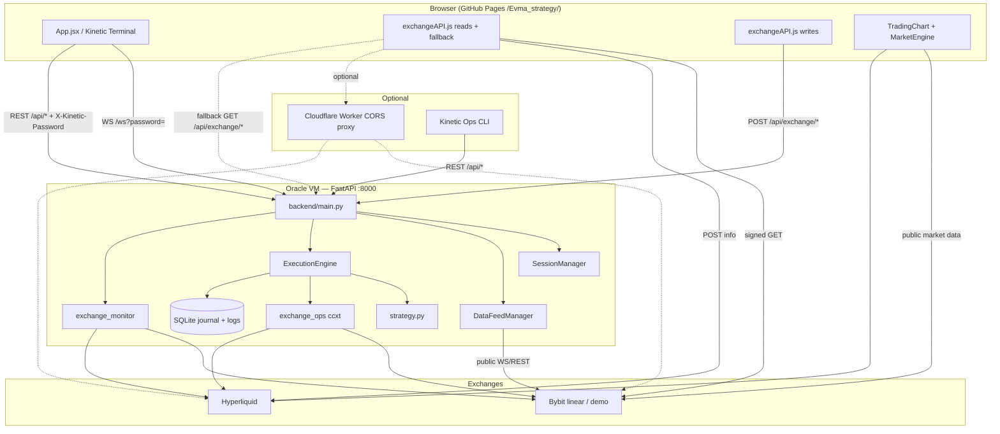
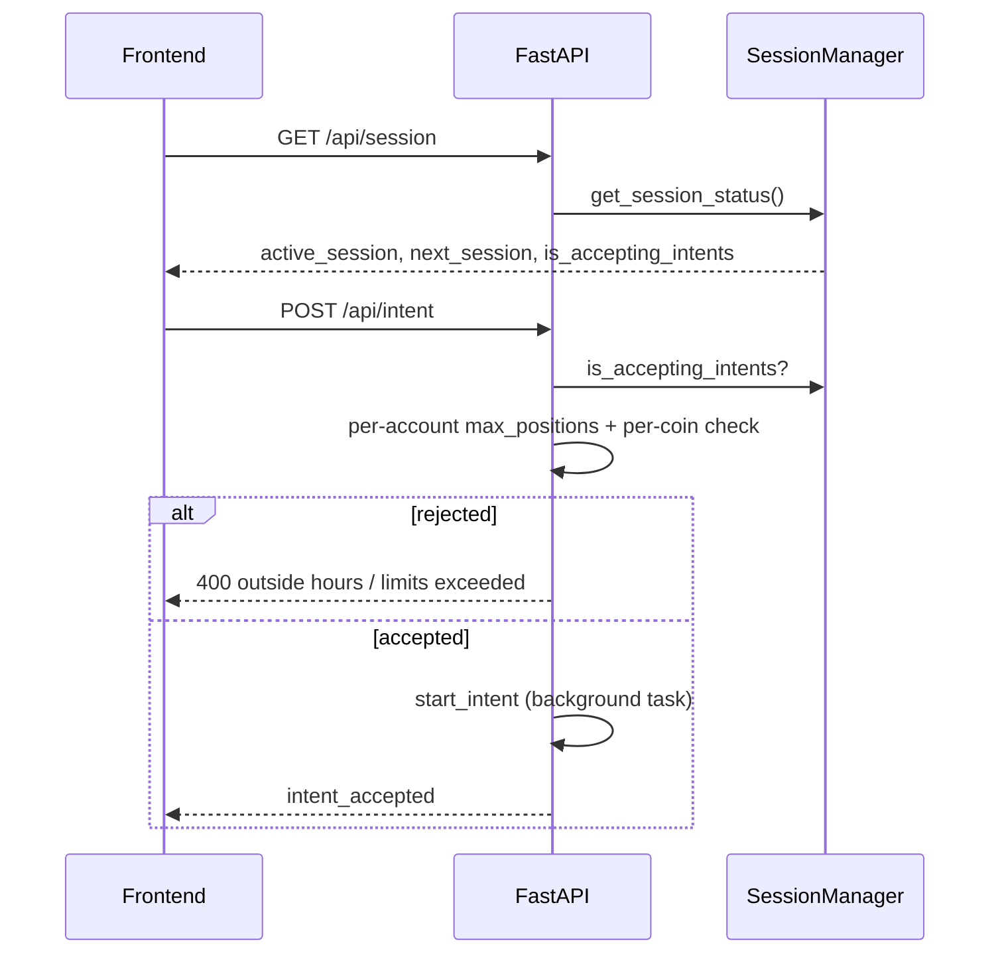
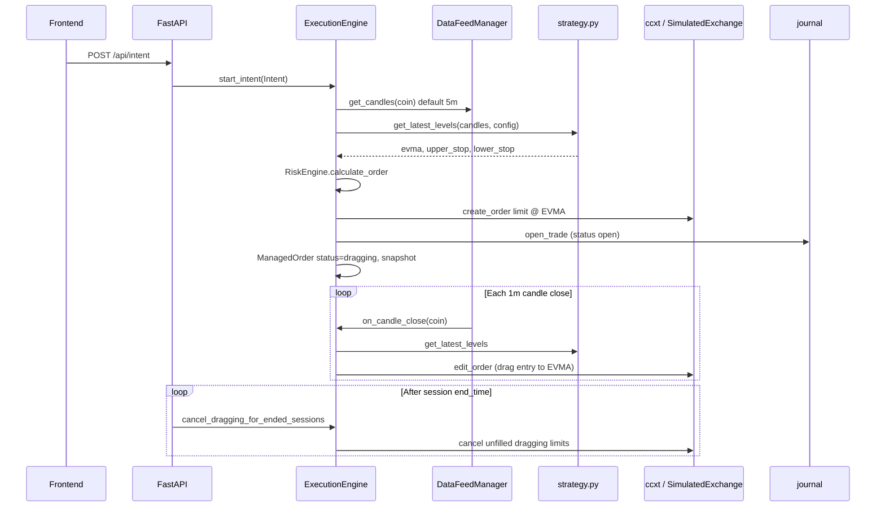
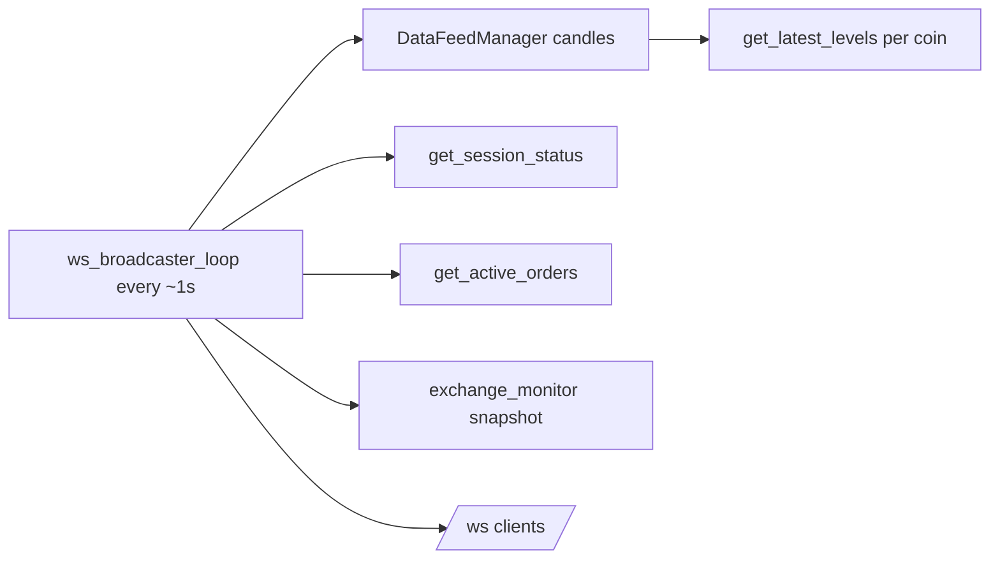

# Architecture

**Kinetic Terminal** (frontend) and **Antigravity Trading System** (backend) form a human-in-the-loop futures desk for BTC, ETH, and SOL.

---

## System context



---

## Component responsibilities

| Component | Responsibility |
|-----------|----------------|
| **App.jsx** | Tabs (home, positions/limits, strategy, journal), Settings (URL/password, account JSON editor), intent form, consumes `/ws` (indicators, session, active orders, **exchange_monitor**) |
| **intentFormHelpers.js** | Per-account risk and R:R form state (fixed vs adjustable, `fixed_tp_rr_by_coin`) |
| **exchangeAPI.js** | **Reads:** Bybit HMAC + Hyperliquid info from browser, backend REST fallback. **Writes:** POST to `/api/exchange/*`. Bybit private WS when backend offline |
| **TradingChart / market/** | Client-side candles (Bybit or Hyperliquid adapter), `evmaDualStops` overlay |
| **main.py** | HTTP API, password middleware, WebSocket broadcaster, background loops |
| **SessionManager** | UK timezone sessions, intent acceptance windows, traded-session audit map |
| **DataFeedManager** | Bybit public linear feed: warm-up REST, live WS, 1m store, aggregate to 3m/5m, fire callbacks on 1m close |
| **strategy.py** | EVMA + dual ATR stops (must match JS) |
| **ExecutionEngine** | Accept intents, place/drag limits, detect fills, TP/SL, journal, persist `active_orders_snapshot.json` |
| **exchange_monitor.py** | Poll enabled accounts via ccxt every 5s; snapshot in `/ws` |
| **exchange_ops.py** | ccxt async helpers for UI writes and monitor reads |
| **accounts_config.py** | Validate, atomic persist, hot-reload `accounts.json` |
| **journal.py / logger.py** | Trade history and operational logs in SQLite under `backend/data/` |
| **kinetic-ops/** | Operator CLI: log sync, account push, status (password auth) |

---

## Session flow

UK time (`Europe/London`, BST/GMT aware via `pytz`):

| Session | Active window | Intent acceptance |
|---------|---------------|-------------------|
| Morning | 06:00–08:00 | 05:45–08:00 |
| Evening | 17:00–22:00 | 16:45–22:00 |



Session IDs: `YYYY-MM-DD_morning` or `YYYY-MM-DD_evening`.

**Limit model:** Per-account `max_positions` and one active managed order per coin. `can_trade(session_id)` is deprecated (always `True`). `mark_session_traded` records coins for display only.

---

## Execution flow (automated intent)



**Entry:** limit at EVMA. **Stop:** lower band (LONG) or upper band (SHORT). **Take profit:** from planned R:R in `RiskEngine`. Bybit entries may attach TP/SL on the order via `_build_entry_order_params`.

**Simulation:** accounts with placeholder API keys use `SimulatedExchange` in `execution.py`.

---

## WebSocket update flow



Payload shape: see [API.md](API.md#websocket-ws). Clients must connect with `?password=` matching `KINETIC_BACKEND_PASSWORD`.

---

## Position monitoring flow

```mermaid
flowchart TD
  WS[Backend WS connected]
  MON[exchange_monitor in payload]
  STALE{Snapshot stale > 10s?}
  REST[POST /api/exchange/refresh-monitor]
  OFF[Backend WS offline]
  BROWSER[Browser signed REST ± CF worker]
  BFALL[GET /api/exchange/positions|open-orders]
  BWS[Bybit private WS]

  WS --> MON --> UI[App.jsx positions/limits]
  MON --> STALE
  STALE -->|yes| REST --> UI
  OFF --> BROWSER --> UI
  BROWSER -->|fail| BFALL --> UI
  OFF --> BWS --> BROWSER
```

---

## Read vs write exchange architecture

| Operation | Path | Auth |
|-----------|------|------|
| Positions, open orders (primary) | Backend `exchange_monitor` → `/ws` | Server ccxt keys in `accounts.json` |
| Positions, open orders (fallback) | Browser → exchange REST | API key in browser (from `/api/accounts`) |
| Positions, open orders (fallback 2) | Browser → `GET /api/exchange/*` | `X-Kinetic-Password` |
| Close, cancel, amend, place limit, TP/SL, batch cancel | Browser → `/api/exchange/*` → ccxt | Server keys + password |
| Bot limit drag / fill | ExecutionEngine → ccxt | Same server keys |
| Public klines (bot + chart) | Bybit public / HL public | None |

This hybrid keeps monitoring reliable via server-side ccxt while preserving browser-signed reads as fallback when the backend WebSocket is down.

---

## Authentication

| Surface | Mechanism |
|---------|-----------|
| `/api/*` | `X-Kinetic-Password` header or `?password=` query |
| `/ws` | `?password=` query param |
| `/healthz`, `/readyz` | No auth |

Set `KINETIC_BACKEND_PASSWORD` on the server; default `yellow` is for local dev only.
